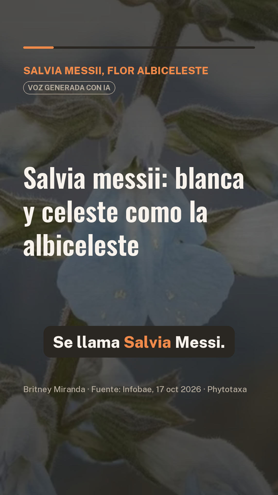

# Salvia messii, flor albiceleste · reel informativo

Reel vertical de 72 segundos sobre *Salvia messii*, la flor andina nueva para la ciencia que homenajea a Lionel Messi.
Está hecho con el flujo de la **Sesión 15 · Del texto a tu voz** del curso
[Data-Science-Python](https://github.com/d2cml-ai/Data-Science-Python/tree/main/sessions/15-texto-a-reel)
(ver [README_clase.md](README_clase.md)), con dos agregados: fotos de fondo por escena y música bajo la voz.



**Video:** [salidas/reel_musica.mp4](salidas/reel_musica.mp4) · versión solo con voz: [salidas/reel.mp4](salidas/reel.mp4)

## Fuente

Víctor Ingrassia, «Salvia messii, la flor andina que une ciencia, biodiversidad y un homenaje a Lionel Messi»,
[Infobae, 17 de octubre de 2026](https://www.infobae.com/america/ciencia-america/2026/10/17/salvia-messii-la-flor-andina-que-une-ciencia-biodiversidad-y-un-homenaje-a-lionel-messi/).
Las notas de lectura con las cifras y citas usadas están en [fuente_infobae.txt](fuente_infobae.txt).

## Pasos

| Paso | Qué se hizo | Archivo |
|---|---|---|
| 1. Texto → guion | Guion de 7 escenas escrito con Claude a partir del artículo y verificado con `guion.py --respuesta` (todas las cifras están en la fuente) | `respuesta.txt` → `salidas/guion.json` |
| 2. Revisión contra la fuente | Dos decisiones anotadas en `revisado_a_mano`: «familia de la menta y el romero» y «clasificación preliminar» | `salidas/guion.json` |
| 3. Voz clonada | Qwen3-TTS 0.6B en CPU, con 16 s de mi voz | `hacer_reel_salvia.py` |
| 4. Subtítulos y control de calidad | Whisper large-v3-turbo; WER por escena: 0.00, 0.05, 0.00, 0.23, 0.00, 0.00, 0.00 | `salidas/reel.srt` |
| 5. Video | 1080×1920 con cifras, subtítulos, aviso de IA y fuente | `salidas/reel.mp4` |
| Extra · fotos | Una foto por escena, oscurecida, con paneo lento y fundido entre escenas | `hacer_reel_salvia.py` (`fondo`, `con_fotos`) |
| Extra · música | Música a −30 LUFS que baja cuando hay voz (sidechain), mezcla final a −14 LUFS | `hacer_reel_salvia.py` (`con_musica`), `salidas/reel_musica.mp4` |

Los posts para LinkedIn, X y Facebook están en [salidas/posts.md](salidas/posts.md).

## Cómo reproducirlo (Windows)

```powershell
uv venv .venv --python 3.12
uv pip install --python .venv\Scripts\python.exe qwen-tts faster-whisper pillow imageio-ffmpeg soundfile jiwer num2words pypdf

python guion.py --texto fuente_infobae.txt --respuesta respuesta.txt   # paso 1; luego revisar salidas/guion.json

$env:HF_HOME = "E:\hf_cache"     # los modelos pesan ~4 GB: conviene un disco con espacio
.venv\Scripts\python.exe hacer_reel_salvia.py --voz mi_voz.m4a --autor "Britney Miranda" `
    --fuente "Infobae, 17 oct 2026 · Phytotaxa" `
    --musica recursos\musica\leberch-background-background-music-610005.mp3 `
    --fotos "recursos\imagenes\imagen 4.jpg" "recursos\imagenes\imagen 1.webp" "recursos\imagenes\imagen 2.jpg" `
            "recursos\imagenes\imagen 3.avif" "recursos\imagenes\imagen 2.jpg" "recursos\imagenes\imagen 4.jpg" `
            "recursos\imagenes\imagen 1.webp"
```

En una laptop con CPU tardó unos 20 minutos: 6 para cargar la voz, 10 para narrar y el resto para subtítulos y video.
La grabación de voz no está en el repositorio (`.gitignore`): cada quien usa la suya.

## Créditos y avisos

- **Voz generada con IA** a partir de la voz de la autora; el video lo indica en pantalla.
- **Código base:** sesión 15 del curso [d2cml-ai/Data-Science-Python](https://github.com/d2cml-ai/Data-Science-Python).
- **Música:** «Background Music» de leberch, [Pixabay](https://pixabay.com/music/), Licencia de Contenido de Pixabay.
- **Imágenes:** descargadas de internet para fines educativos; los derechos son de sus autores. La imagen 2 tiene
  marca de agua de su autor, la imagen 3 es un montaje de prensa y la imagen 1 parece una ilustración generada con IA.
  Si eres autor de alguna y quieres que se retire o se acredite, abre un *issue*.
